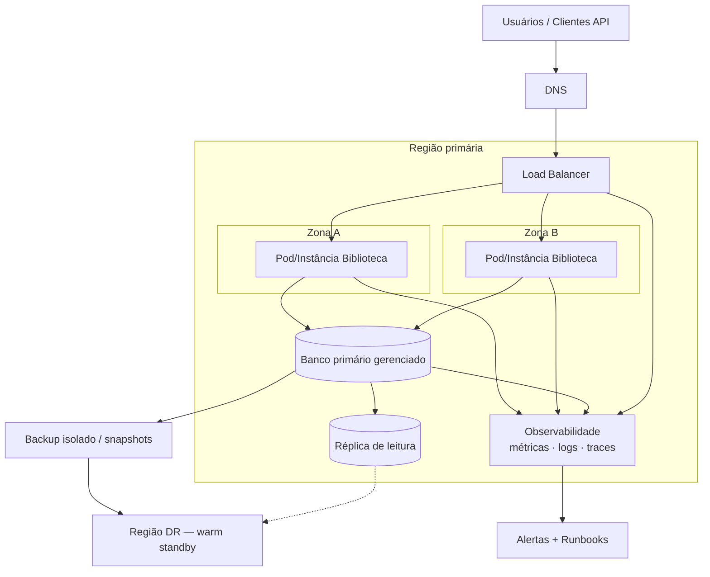
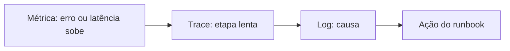

# Diagrama da arquitetura — Biblioteca observável e resiliente

Serviço-base do T6/T7: **Biblioteca** (Spring Boot).  
A proposta evolui o laboratório com H2 em memória para uma arquitetura operacionalmente realista: múltiplas zonas, banco gerenciado, telemetria e cópia isolada para DR.

## Diagrama (visão geral)

## Componentes

| Camada | Componente | Papel |
|---|---|---|
| Entrada | DNS + Load Balancer | Roteia só para instâncias saudáveis |
| Aplicação | ≥ 2 instâncias em 2 zonas | Remove ponto único de falha da app |
| Dados | Banco gerenciado + réplica | Persistência e failover de leitura/primário |
| Observabilidade | Métricas, logs, traces | Detectar, diagnosticar e alertar |
| Recuperação | Backup isolado + warm standby | Atende RPO/RTO do DR |

## Fluxo de correlação (operação)

## Notas de projeto

1. **H2 em memória não entra na arquitetura-alvo de HA/DR** — serve só ao laboratório. Em produção/proposta T7 usa-se banco externo.
2. Sessões e JWT: a API já é stateless com JWT; a UI Thymeleaf pode usar sticky session no LB ou sessão externa se necessário.
3. Dependências críticas monitoradas: LB, instâncias da app, banco, DNS e pipeline de deploy.
